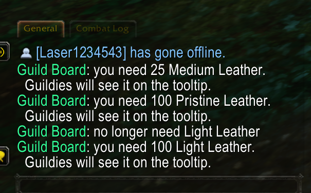
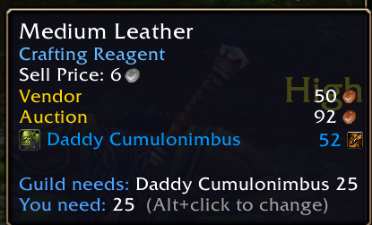
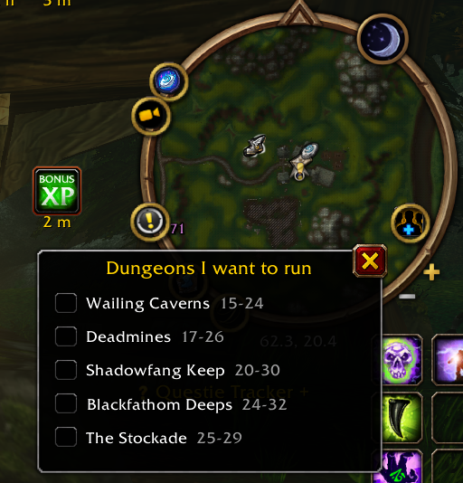

# Guild Board and friends: WoW Forever addons

Small addons for World of Warcraft: Forever. Each folder is one addon.

| Addon | What it does | Command |
|---|---|---|
| **Guild Board** | Built for a guild of friends. Tooltips show who in the guild needs an item, can make it, could use it to level a profession, or would get an upgrade from it. Flag dungeons you want to run from the minimap button. Plus shared quests, a death log, level-up popups and a guild window with alts grouped under their main. | `/gb` or the minimap button |
| **Claude Paste** | One click gives you a copy-and-paste summary of your character: gear, talents, quests, bags, professions. | `/cp` |
| **Fish Focus** | While you fish it turns the game sound up, mutes music, and shows a cast bar, so the bobber splash is easy to catch. | `/fishfocus` |

## Install

**Easiest: CurseForge.** Search for Guild Board in the CurseForge app with your WoW Forever install selected, click Install, and it keeps itself updated. (Link coming once CurseForge approves the project.)

**By hand:**

1. Open the [Releases](../../releases) page and download the zip for the addon you want.
2. Right-click the zip and choose Extract All.
3. Move the addon folder into `World of Warcraft\_forever_\Interface\AddOns`.
   It should look like `AddOns\GuildBoard\GuildBoard.toc`, not a folder inside a folder.
4. Restart WoW. On the character select screen click AddOns and make sure it is checked.

To update, download the new zip and replace the old folder.

## Make a button for it (macro)

You can type the commands in chat, or put them on a button:

1. Press Enter, type `/macro`, press Enter again.
2. Click **New**.
3. Type a name (for example `Board`), click any icon, click **Okay**.
4. Click in the big empty text box and type the command, for example `/gb`
5. Drag the macro's icon from the top of that window onto an empty action bar slot.
6. Close the macro window. Clicking the button now runs the command.

Useful ones to make:

| Button | Type this in the macro | What it does |
|---|---|---|
| Board | `/gb` | Opens the guild roster |
| Run | `/gb run` | Opens the report for the dungeon or raid you just did |
| Paste | `/cp` | Opens your own character summary (Claude Paste) |

## Post it in Discord

Every one of these windows opens with the text already highlighted.

1. Click the button (or type the command).
2. Press **Ctrl+C** to copy.
3. Click into the Discord channel and press **Ctrl+V** to paste, then Enter.
4. If Discord says the message is too long and offers to send it as a file, say yes. It posts as a small text file anyone can open.
5. Back in game, press **Esc** to close the window.

Where to post what:

- **Guild roster** (`/gb`): the guild's roster channel, whenever someone wants a fresh copy. Only one person needs to post it, because everyone's addon holds the whole roster.
- **Run report** (`/gb run`): after a dungeon or raid. Reset your damage meter before the first pull so the report only covers that run.
- **Character summary** (`/cp`): send it to whoever is helping you with gear, talents or quests.

## Guild Board: what it does

No commands needed for most of it. It works through tooltips and one minimap button.

**On item tooltips**
- Blue **Guild needs: Kris 10** means a friend asked for it. To ask for something yourself, **Alt+click** the item anywhere (bags, chat link, auction house) and type how many. It counts down as the items land in your bags.
- Yellow **Could use (leveling)** means a friend's profession is at the skill level where that material levels it. Send it instead of selling it.
- Green **Upgrade for** means it's an item level upgrade for a friend who can use it (armor type, weapon skill, main stat and level are checked).
- Gold **Guild can make** means a friend knows the recipe. Each crafter opens their profession window once to share it.

 

**Minimap button**
- Left-click: tick the dungeons you want to run. Friends in level range get a heads-up. A tick turns off by itself when you click it again, leave that dungeon after killing 3+ bosses, out-level it, or after 48 hours.
- Right-click: the guild window.

**At the mailbox:** a **Send needs** button fills in a mail to whoever needs something you're carrying. You still click Send.

**Guild window (`/gb` or right-click the minimap button)**
- Roster from the guild list, with alts grouped under their main from guild notes ("alt of Kris", "Kris alt" or just "Kris"). Anyone offline 7+ days is hidden until they log back in.
- Dungeon flags, needs, level race (and who's falling behind), shared quests, the Hall of Shame (deaths this week), hearths and flight paths you're missing, and a party gear check.

**Also**
- A popup when a friend levels up, and a chat line when a friend dies.
- When you zone into a dungeon, a quick check of empty gear slots in your group.
- If a friend has a newer version, it tells you once so you know to update.

**Commands, if you want them**
- `/gb note <text>` and `/gb spec <text>` set your note and spec.
- `/gb run` shows damage, healing and damage taken for the run (`/gb run last` for the last fight).
- `/gb bug <what happened>` opens a bug report to paste in #addons.
- `/gb sync` asks everyone online to resend.
- Officers only: `/gb disable <feature>` switches a broken feature off for the whole guild until a fix ships, `/gb enable <feature>` turns it back on.

**If something breaks:** the addon catches its own errors. A feature that keeps failing pauses itself until `/reload` instead of breaking the rest, and damaged saved data is repaired on login.

## Fish Focus

Start fishing and Fish Focus does the rest. It turns the game sound up and mutes the music so the bobber splash is easy to hear, and it puts a bar on screen that counts down the cast. When you stop fishing, your sound settings go back to how they were.

- When you hear the splash, click the bobber (or press your Interact key).
- `/fishfocus` turns it off or back on.

## What is shared

Guild Board only talks over the game's guild addon channel, so only your guild sees it.
It shares level, class, spec, item level per gear slot, zone, professions, known recipes, your note, your needs and
dungeon flags, your quest list, your deaths, your hearth location and known flight paths, and the text of any
Guild Board error (so bugs reach the maintainer). It never shares gold or bags. None of these addons contact the internet.

## Want to help?

- **Found a bug or have an idea?** Open an [Issue](../../issues). Say what you typed, what you expected, and what happened. A screenshot helps.
- **Want to change the code?** Fork this repo (the Fork button at the top), make your change in your copy, and send a pull request. Nothing changes here until it is reviewed and accepted.
- **Before you send it:** load the addon in game, run the commands you touched, and say in the pull request what you tested.
- Each addon is a folder of `.lua` files and one `.toc` file. No build tools needed.

## License

MIT. Use it, change it, share it. See [LICENSE](LICENSE).

## Changes

See [CHANGELOG.md](CHANGELOG.md).
