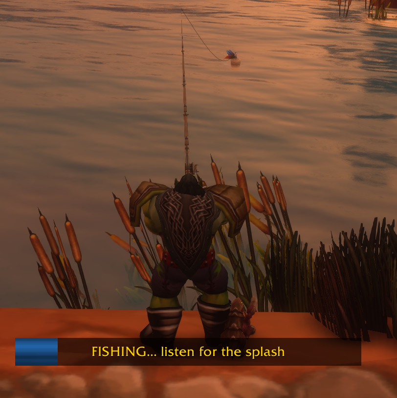

# Guild Board and friends: WoW Forever addons

Small addons for World of Warcraft: Forever. Each folder is one addon.

| Addon | What it does | Command |
|---|---|---|
| **Guild Board** | Guildmates who run it share level, class, spec, item level, zone, professions and a short note with each other in game. Also builds a damage, healing and damage-taken report after a dungeon or raid. | `/gb` |
| **Claude Paste** | One click gives you a copy-and-paste summary of your character: gear, talents, quests, bags, professions. | `/cp` |
| **Fish Focus** | While you fish it turns the game sound up, mutes music, and shows a cast bar, so the bobber splash is easy to catch. | `/fishfocus` |

## Install

1. Open the [Releases](../../releases) page and download the zip for the addon you want.
2. Right-click the zip and choose Extract All.
3. Move the addon folder into `World of Warcraft\_forever_\Interface\AddOns`.
   It should look like `AddOns\GuildBoard\GuildBoard.toc`, not a folder inside a folder.
4. Restart WoW. On the character select screen click AddOns and make sure it is checked.

To update, download the new zip and replace the old folder.

## Make a button for it (macro)

You can type the commands in chat, or put them on a button:

1. Press Enter, type `/macro`, press Enter again.
2. Click **New**.
3. Type a name (for example `Board`), click any icon, click **Okay**.
4. Click in the big empty text box and type the command, for example `/gb`
5. Drag the macro's icon from the top of that window onto an empty action bar slot.
6. Close the macro window. Clicking the button now runs the command.

Useful ones to make:

| Button | Type this in the macro | What it does |
|---|---|---|
| Board | `/gb` | Opens the guild roster |
| Run | `/gb run` | Opens the report for the dungeon or raid you just did |
| Paste | `/cp` | Opens your own character summary (Claude Paste) |

## Post it in Discord

Every one of these windows opens with the text already highlighted.

1. Click the button (or type the command).
2. Press **Ctrl+C** to copy.
3. Click into the Discord channel and press **Ctrl+V** to paste, then Enter.
4. If Discord says the message is too long and offers to send it as a file, say yes. It posts as a small text file anyone can open.
5. Back in game, press **Esc** to close the window.

Where to post what:

- **Guild roster** (`/gb`): the guild's roster channel, whenever someone wants a fresh copy. Only one person needs to post it, because everyone's addon holds the whole roster.
- **Run report** (`/gb run`): after a dungeon or raid. Reset your damage meter before the first pull so the report only covers that run.
- **Character summary** (`/cp`): send it to whoever is helping you with gear, talents or quests.

## Guild Board commands

- `/gb` shows the roster and a "who can make what" list. Ctrl+C copies it for Discord.
- `/gb note <text>` sets your note, for example `/gb note need Medium Leather`.
- `/gb spec <text>` sets your spec or role if the game does not report it.
- `/gb run` shows a report for the whole run. `/gb run last` covers the last fight.
- `/gb sync` asks everyone online to resend.

## Fish Focus

Start fishing and Fish Focus does the rest. It turns the game sound up and mutes the music so the bobber splash is easy to hear, and it puts a bar on screen that counts down the cast. When you stop fishing, your sound settings go back to how they were.

- When you hear the splash, click the bobber (or press your Interact key).
- `/fishfocus` turns it off or back on.

## What is shared

Guild Board only talks over the game's guild addon channel, so only your guild sees it.
It shares level, class, spec, average item level, zone, professions and your note.
It never shares gold, bags or individual gear. None of these addons contact the internet.

## Changes

See [CHANGELOG.md](CHANGELOG.md).
